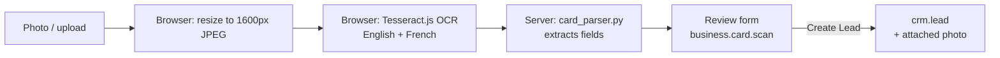

<div align="center">


# Business Card Scanner for Odoo 19

**Snap a business card, review the detected details, create a CRM lead. No IAP credits, nothing to install on the server.**


</div>

---

## Table of contents

- [Overview](#overview)
- [Features](#features)
- [How it works](#how-it-works)
- [Requirements](#requirements)
- [Installation](#installation)
- [Usage](#usage)
- [Configuration and customization](#configuration-and-customization)
- [Technical reference](#technical-reference)
- [Testing](#testing)
- [Privacy and data flow](#privacy-and-data-flow)
- [Limitations](#limitations)
- [Troubleshooting](#troubleshooting)
- [Contributing](#contributing)
- [License](#license)

## Overview

Sales teams collect dozens of business cards at trade shows and meetings. Typing them into the CRM is slow, and Odoo's built-in scanning relies on paid IAP credits.

**Business Card Scanner** adds a standalone *Business Cards* app to Odoo. A salesperson takes a photo with a phone (or uploads images from a computer), the text is read **in the browser** with the open-source [Tesseract.js](https://github.com/naptha/tesseract.js) OCR engine, and a rule-based parser extracts the contact details. The salesperson reviews the result and creates the lead in one click.

## Features

| | |
|---|---|
| 📷 **Capture anywhere** | Native camera on mobile, in-page webcam preview on desktop (with front/back switch), file picker, or drag and drop. |
| 🗂️ **Batch scanning** | Select or drop several cards at once; they are read one after another and opened as a review list. |
| 🧠 **Smart field detection** | Contact name, company, job position, email, two phone numbers, website and address, in English and French. |
| ✅ **Review before creating** | A review form shows the card photo next to the detected fields so the salesperson can fix anything before the lead exists. |
| 🔁 **Re-analyze** | Edit the raw OCR text and re-run the parser with one button. |
| 👥 **Duplicate detection** | Warns when a lead with the same email already exists and links an existing contact automatically. |
| 📎 **Photo kept on the lead** | The card image is attached to the new lead and a note is posted in the chatter. |
| 🎯 **Assignment** | Choose salesperson, sales team and tags from the review form. |
| 💸 **Free** | No IAP credits, no API key, no server-side OCR packages. Works on Odoo.sh. |

## How it works



1. **Capture**: the image is resized in the browser (max 1600 px) and converted to JPEG, which keeps OCR fast on phones and uploads light.
2. **OCR in the browser**: Tesseract.js is loaded on demand from the jsDelivr CDN. The engine and language data (`eng`, `fra`) are downloaded on first use, then cached by the browser.
3. **Parsing on the server**: the raw text is sent to `business.card.scan.create_from_ocr()`. The pure-Python parser in `models/card_parser.py` detects emails, phones and websites, then uses keyword lists and heuristics (email local part vs. name, legal forms, job titles, address words) to pick the name, company, position and address.
4. **Review**: a `business.card.scan` record is created in the *To Review* state and opened for the salesperson.
5. **Lead creation**: *Create Lead* builds a `crm.lead`, attaches the card photo, posts a chatter message and moves the scan to *Lead Created*.

## Requirements

- **Odoo 19.0** (Community or Enterprise, including Odoo.sh)
- Odoo module: `crm`
- **Users' browsers** need access to `cdn.jsdelivr.net` on the first scan (to download the OCR engine)
- **HTTPS** is required for the in-page webcam on desktop (browser security rule). Mobile camera and file upload work regardless.

No Python package or system dependency is needed on the server.

## Installation

### Standard Odoo

```bash
cd /path/to/your/addons
git clone https://github.com/Stream-line-dev/odoo-business-card-scan.git
# add the cloned folder to your addons_path, then:
./odoo-bin -d <database> -i business_card_scan
```

Or, from the Odoo interface: enable developer mode, go to **Apps → Update Apps List**, search for *Business Card Scanner* and click **Activate**.

### Odoo.sh

1. Copy the `business_card_scan` folder to the root of your project repository (next to your other modules), or add this repository as a Git submodule.
2. Commit and push to a **staging** branch first:
   ```bash
   git add business_card_scan
   git commit -m "[ADD] business_card_scan"
   git push
   ```
3. When the build is ready, install the app from **Apps**.
4. Once validated, merge into production.

## Usage

1. Open the **Business Cards** app (visible to users with the *Sales / User* access right).
2. Go to **Scan**, then:
   - **Take a photo**: opens the phone camera, or the webcam preview on a computer;
   - **Upload**: choose one or more images, or drag and drop them onto the page.
3. Wait for the three steps: *OCR engine → Reading → Saving*.
4. Check the review form: fix any field, pick the salesperson, sales team and tags.
   - A yellow banner appears if a lead with the same email already exists.
   - The *Scanned Text (OCR)* tab holds the raw text; edit it and click **Re-analyze Text** if needed.
5. Click **Create Lead**. The lead opens with the card photo attached.

All scans stay available under **Business Cards → Cards** (kanban and list views, filters *To Review*, *Lead Created*, *My Scans*).

## Configuration and customization

The parser is driven by keyword lists in [`business_card_scan/models/card_parser.py`](business_card_scan/models/card_parser.py). Adapt them to your market:

| Constant | Purpose | Example additions |
|---|---|---|
| `JOB_HINTS` | Words that identify a job title | `"plant manager"`, `"buyer"` |
| `COMPANY_HINTS` | Legal forms and words that identify a company line | `"gmbh"`, `"s.p.a"` |
| `ADDRESS_HINTS` | Words that identify an address line | street types, city names |
| `GENERIC_DOMAINS` | Free email providers (not used to guess the company) | `"laposte"` |

Run the [tests](#testing) after any change.

To change OCR languages, edit `OCR_LANGS` in [`static/src/scan_action.js`](business_card_scan/static/src/scan_action.js) using [Tesseract language codes](https://tesseract-ocr.github.io/tessdoc/Data-Files-in-different-versions.html) (for example `["eng", "fra", "spa"]`). Each extra language adds a few MB to the first download.

## Technical reference

### Module structure

```
business_card_scan/
├── __manifest__.py
├── models/
│   ├── business_card_scan.py   # business.card.scan model and lead creation
│   └── card_parser.py          # pure-Python text parser (no Odoo import)
├── views/
│   └── business_card_scan_views.xml   # form, list, kanban, search, actions, menus
├── security/
│   └── ir.model.access.csv     # access for sales_team.group_sale_salesman
├── static/
│   ├── description/            # app icon
│   └── src/                    # OWL client action + Tesseract.js integration
│       ├── scan_action.js
│       ├── scan_action.xml
│       └── scan_action.scss
└── tests/
    └── test_card_parser.py     # parser unit tests, runnable without Odoo
```

### Model `business.card.scan`

| Field | Type | Description |
|---|---|---|
| `image` | Image | Card photo (max 1600 px) |
| `raw_text` | Text | Raw OCR output |
| `contact_name`, `partner_name`, `function` | Char | Name, company, job position |
| `email`, `phone`, `phone_2`, `website`, `street` | Char | Contact details |
| `notes` | Text | Lines the parser could not classify |
| `user_id`, `team_id`, `tag_ids` | Relational | Lead assignment |
| `partner_id` | Many2one | Existing contact matched by email |
| `duplicate_lead_id` | Many2one (computed) | Existing lead with the same email |
| `lead_id` | Many2one | Lead created from this scan |
| `state` | Selection | `draft` (To Review) / `done` (Lead Created) |

### Public methods

| Method | Description |
|---|---|
| `create_from_ocr(image_b64, raw_text)` | `@api.model`. Called by the client action; parses the text and returns the new scan id. |
| `action_reparse()` | Re-runs the parser on `raw_text` for draft scans. |
| `action_create_lead()` | Creates the `crm.lead`, attaches the photo, posts in the chatter. |
| `_prepare_lead_values()` | Returns the `crm.lead` values; override it to add your own fields. |

### Extending lead creation

```python
from odoo import models


class BusinessCardScan(models.Model):
    _inherit = "business.card.scan"

    def _prepare_lead_values(self):
        vals = super()._prepare_lead_values()
        vals["source_id"] = self.env.ref("my_module.utm_source_trade_show").id
        return vals
```

### Security

| Group | Read | Write | Create | Delete |
|---|:-:|:-:|:-:|:-:|
| Sales / User (`sales_team.group_sale_salesman`) | ✓ | ✓ | ✓ | ✓ |

## Testing

The parser has no Odoo dependency, so its tests run with plain Python:

```bash
python3 business_card_scan/tests/test_card_parser.py -v
```

## Privacy and data flow

- **OCR runs entirely in the user's browser.** Card images are never sent to a third-party OCR service.
- The only external request is the download of the Tesseract.js engine and language files from `cdn.jsdelivr.net`.
- Images and extracted text are stored in your Odoo database only.

## Limitations

- OCR quality depends on the photo: use good light, hold the card flat and fill the frame.
- Email, phone and website detection is very reliable. Name, company and position rely on heuristics and sometimes need a manual fix, which is why every scan goes through the review form.
- Default languages are English and French. Cards in non-Latin scripts need extra Tesseract languages.
- The first scan on a device needs internet access to download the OCR engine (a few MB).

## Troubleshooting

| Symptom | Fix |
|---|---|
| *"Scan failed. Check your internet connection…"* | The browser could not reach `cdn.jsdelivr.net`. Check the network, proxy or Content Security Policy. |
| *"Camera is not available here (HTTPS is required)"* | Serve Odoo over HTTPS, or use **Upload** instead. |
| *"Camera access was denied"* | Allow camera access for the Odoo site in the browser settings. |
| The app menu is missing | The user needs the *Sales / User* access right. |
| A field is often wrong for your cards | Add keywords to the hint lists in `card_parser.py`, add a test case, run the tests. |

## Contributing

Issues and pull requests are welcome.

1. Fork the repository and create a branch from `main`.
2. For any parser change, add a test case in `tests/test_card_parser.py` (a sample card text and the expected fields).
3. Run the tests and check that the module installs on a fresh Odoo 19 database.
4. Open a pull request describing the change.

Commit messages follow the [Odoo guidelines](https://www.odoo.com/documentation/19.0/contributing/development/git_guidelines.html) (`[ADD]`, `[FIX]`, `[IMP]`, …).

## License

Released under the [GNU Lesser General Public License v3.0](LICENSE) (LGPL-3), the same license as Odoo Community.

Tesseract.js is distributed under the Apache License 2.0. It is loaded at runtime from its CDN and is not bundled in this repository.

---

<div align="center">
Developed by <b>Stream lean industry 4.0</b>
</div>
